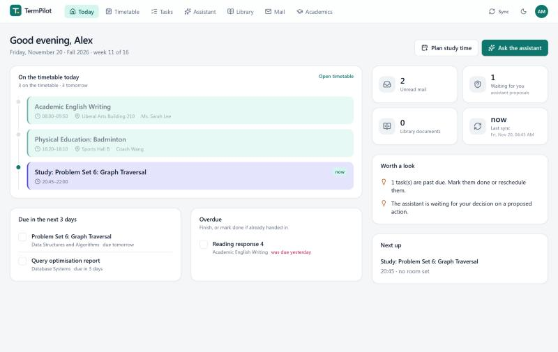
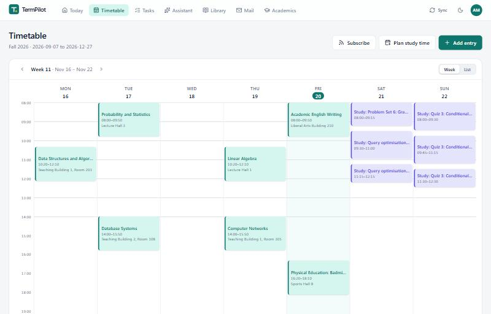
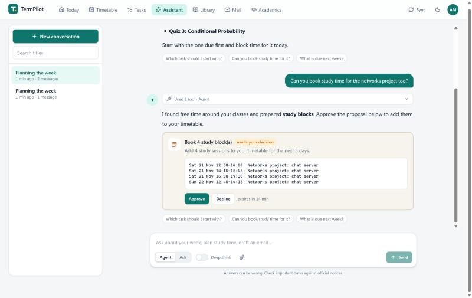
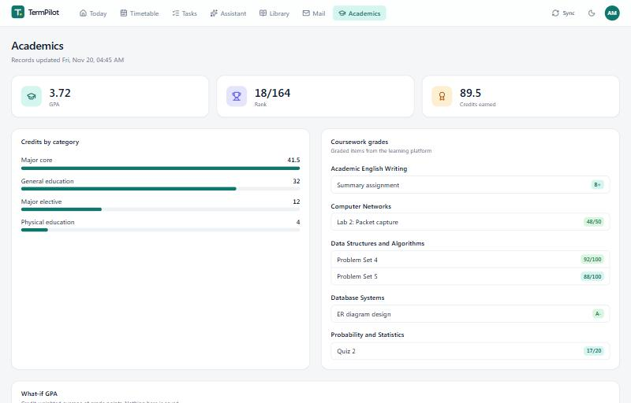
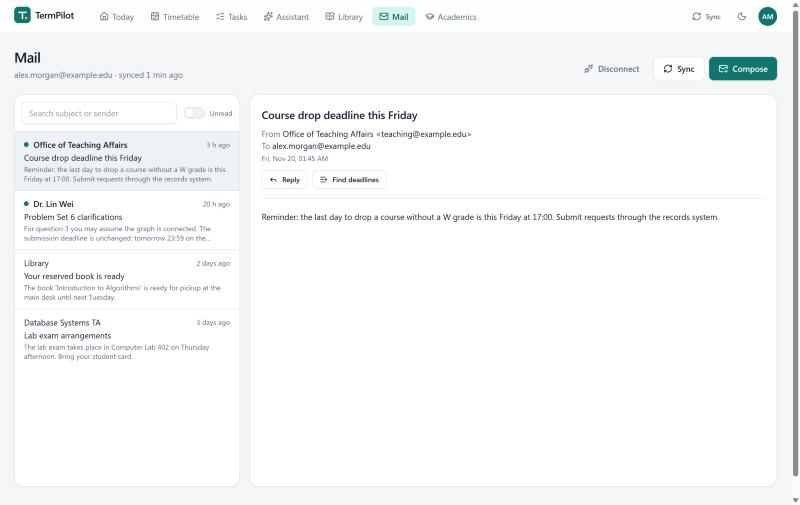

# TermPilot

[中文版 README](README.zh-CN.md)

TermPilot is a web app for keeping track of a university semester. At my university the timetable lives in
the academic records system, assignments and grades are on Blackboard, and a lot of notices only arrive by
email. Checking all of them every day got old, so I wrote something that logs in once, imports everything
into one database and shows it on a single dashboard.

It also has an LLM assistant. It can look things up in your own data (timetable, tasks, grades, mail,
uploaded notes) and it can prepare actions like booking study time or sending an email, but it never runs
them on its own. Every action shows up as a card first and only happens after you press Approve.

The default campus endpoints are the SUSTech ones (CAS, Blackboard and TIS). There is also a demo mode with
made-up data, so you can click through everything without a student account.

| Today | Timetable |
| --- | --- |
|  |  |
| **Assistant, waiting for approval** | **Academics** |
|  |  |
| **Mail** | |
|  | |

## Features

- Today page: what's on now and next, things due in the next 72 hours, overdue tasks and timetable clashes.
  Times are always in the campus time zone, not whatever the browser is set to.
- Timetable: imported from the records system. Period numbers like "3-4节" become real times, and week
  patterns like "1-15单周" (odd weeks only) are understood. You can add your own entries, and if you edit an
  imported course the change survives the next sync.
- Study planner: finds free time around your classes and books study blocks for open tasks. The task with
  the earliest deadline goes first, and block length depends on how much effort you estimated.
- Tasks: deadlines from Blackboard plus your own to-dos. Priority, effort and notes you add are kept when
  you sync again.
- Calendar subscription: a private .ics link for Google Calendar, Apple Calendar or Outlook.
- Assistant with three modes. *Agent* can call 16 tools over your data. *Ask* answers only from your
  uploaded documents and attachments, with numbered citations. *Research* also searches the web. With
  "Deep think" on, a reasoning model writes the final answer.
- Library: upload lecture notes and slides (PDF including scanned ones, Word, PowerPoint, Excel, Markdown,
  HTML). Search is hybrid, keyword plus vector, and you can generate a summary, a practice quiz or
  flashcards from any document.
- Mail: connect an IMAP/SMTP mailbox. HTML mail is shown in a sandboxed iframe with remote images blocked.
  "Find deadlines" pulls dated tasks out of a message.
- Academics: GPA, rank, credits by category, coursework grades, course files and a what-if GPA calculator.

## Running it locally (demo mode)

You need Python 3.11+ and Node.js 22 or 24.

Backend:

```bash
cd backend
python -m venv .venv
source .venv/bin/activate          # Windows: .venv\Scripts\activate
pip install -r requirements-dev.txt
TP_DEMO_MODE=true python -m termpilot --reload
```

Frontend, in a second terminal:

```bash
cd frontend
npm install
npm run dev
```

Open http://localhost:3000, log in with `demo` / `demo` and click **Import my semester**. On the Mail page
the demo mailbox accepts the code `demo`. The API docs (Swagger) are at http://localhost:8000/docs.

If you don't have an LLM API key, there is a fake model server you can use instead:

```bash
python scripts/fake_model_server.py     # listens on port 8100
TP_DEMO_MODE=true TP_LLM_BASE_URL=http://127.0.0.1:8100/v1 TP_LLM_API_KEY=offline python -m termpilot
```

Its replies are canned, so it's only good for checking that the chat UI and the approval cards work.

## Real setup

Copy `backend/.env.example` to `backend/.env` and fill it in. The ones that matter most:

- `TP_SECRET_KEY`: required in production. It signs login tokens and encrypts the stored cookies.
- `TP_LLM_API_KEY`: any OpenAI-compatible API works. The defaults point at DeepSeek; change
  `TP_LLM_BASE_URL` and the model names for something else.
- `TP_EMBEDDING_API_KEY` and the `TP_SEARCH_*` settings: needed for the document library, together with a
  running Elasticsearch. Run `python scripts/fetch_models.py` once to download the parsing and OCR models.
- `TP_WEB_SEARCH_API_KEY` (serper.dev) for Research mode and `TP_RERANK_API_KEY` for reranking. Both optional.
- `TP_CAMPUS_*` if you want to point it at another CAS / Blackboard / records system.

There is also a compose file that starts the API, the frontend, PostgreSQL and Elasticsearch together:

```bash
cp backend/.env.example backend/.env     # edit it first
docker compose up --build                # frontend on :3000, API on :8000
```

## How it's built

- Backend: FastAPI, SQLAlchemy 2.0 and Pydantic. SQLite by default, PostgreSQL in Docker.
- Frontend: Nuxt 4 as a single-page app, Pinia, Tailwind CSS v4, TypeScript in strict mode.
- Assistant: any OpenAI-compatible chat API, using native function calling. Answers are streamed to the
  browser with server-sent events.
- Library: Elasticsearch, plus document parsing and search code adapted from RAGFlow.

The backend is split into routes, services and adapters. Everything that talks to the outside world (campus
systems, the mailbox, the chat model, the search index) sits behind a small interface that also has an
offline version. Demo mode and the tests both run on those offline versions.

More details:

- [Architecture](docs/architecture.md)
- [API reference](docs/api.md)
- [Development notes](docs/development.md)

## Project layout

```text
backend/
  termpilot/
    api/          routes, request/response schemas, dependencies
    services/     the actual use cases (sync, timetable, tasks, planner, mail, library, ...)
    assistant/    streaming answers, tools, approvals, prompts
    campus/       CAS login, records system, Blackboard, terms and periods, demo data
    knowledge/    text extraction, embeddings, search index; engine/ is the adapted RAGFlow code
    mail/         IMAP/SMTP and message parsing
    llm/          OpenAI-compatible client
    db/           SQLAlchemy models and sessions
    security/     tokens and encryption of stored credentials
  tests/          pytest
  scripts/        model download, fake model server
frontend/
  app/            pages, components, Pinia stores, API client, utils
  tests/          vitest
docs/
```

## Tests

```bash
cd backend
pytest                              # 73 tests
ruff check termpilot tests scripts
```

```bash
cd frontend
npm test                            # 14 tests
npm run typecheck
```

GitHub Actions runs the same checks on every push and also builds both Docker images.

## Security

A few things I paid attention to:

- The campus password is only used for the login request and is never saved. What gets stored are the
  session cookies, encrypted with a key derived from `TP_SECRET_KEY`. Mailbox authorization codes are
  stored the same way and deleted when you disconnect.
- Logging out bumps a counter on the account, which kills every token issued before it, calendar links
  included.
- Every query is filtered by the logged-in student, and workspace paths can't leave the student's own folder.
- Model output is rendered as Markdown with raw HTML turned off.

## Known issues

- The campus adapters parse web pages, so when the university changes a page the matching parser can
  break. A broken source only fails its own step of the sync; the others still run.
- The library doesn't work without Elasticsearch and an embedding API. OCR for scanned PDFs needs about
  200 MB of extra models.
- Mail is read-only on the server side. TermPilot copies messages but doesn't mark anything as read.

## Credits

The parsing and search code in `backend/termpilot/knowledge/engine` is adapted from
[RAGFlow](https://github.com/infiniflow/ragflow) v0.16.0 (Apache License 2.0). See
[THIRD_PARTY_NOTICES.md](THIRD_PARTY_NOTICES.md) for what was changed.
