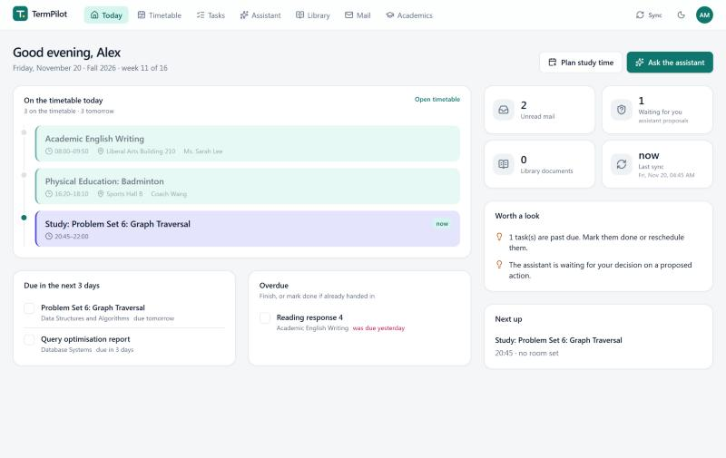
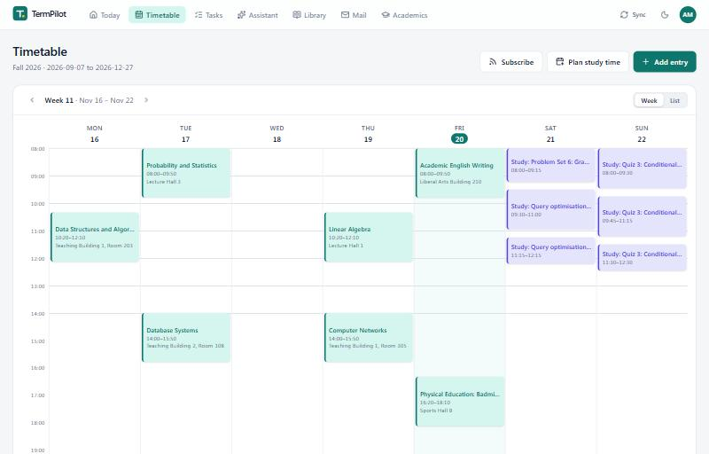
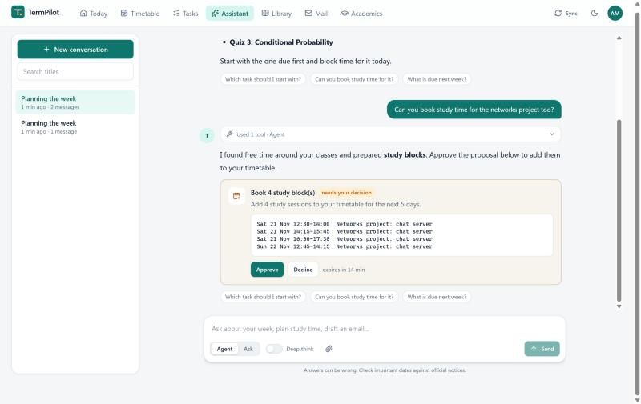
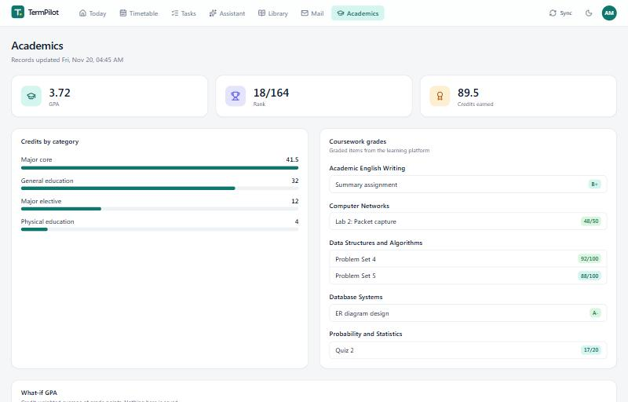
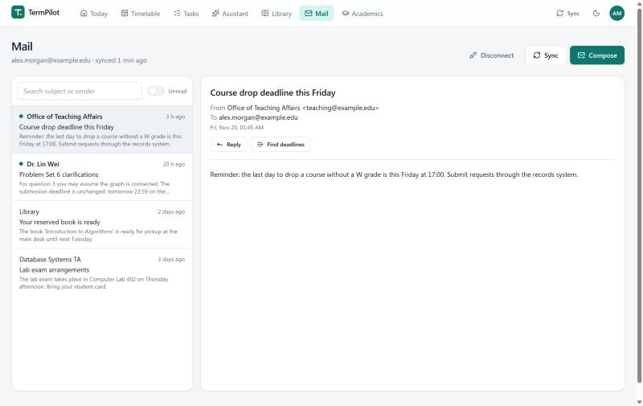

# TermPilot

[English](README.md) | 中文

> 这是英文 README 的中文版。两边如果有对不上的地方，以英文版为准。

TermPilot 是我写的一个用来管理大学学期的网页应用。我们学校的课表在教务系统里，作业和成绩在 Blackboard 上，
不少通知又只发邮件，每天要来回翻好几个网站，还是经常漏看。所以我就做了这个：登录一次，把这些数据都导进同一个数据库，
在一个页面上看完。

它还带了一个大模型助手，可以查你自己的课表、任务、成绩、邮件和上传的资料，也能帮你安排复习时间、写邮件。
不过它不会自己动手：凡是会改数据的操作，都会先变成一张卡片，你点了 Approve 才会真正执行。

校园系统默认对接的是南科大的 CAS、Blackboard 和 TIS。另外有一个演示模式，用的是编出来的数据，没有学生账号也能把功能点一遍。

| 今日 | 课表 |
| --- | --- |
|  |  |
| **助手（等待批准）** | **学业** |
|  |  |
| **邮件** | |
|  | |

## 功能

- 今日页：正在上和接下来的课、72 小时内要交的东西、已经过期的任务，还有课表冲突。时间一律按学校所在时区算，不看浏览器的时区设置。
- 课表：从教务系统导入。"3-4节"这种节次会换算成具体时间，"1-15单周"这种周次写法也能识别。可以自己加日程；
  改过的导入课程，下次同步不会被覆盖回去。
- 复习规划：在课与课之间找空闲时间，给还没完成的任务排复习时段。截止早的先排，每段多长取决于你给任务填的预估工作量。
- 任务：Blackboard 上的截止日期，加上你自己的待办。自己填的优先级、预估时长和备注，重新同步也不会丢。
- 日历订阅：生成一个私有的 .ics 链接，可以加到 Google 日历、Apple 日历或者 Outlook 里。
- 助手有三种模式。*Agent* 可以调用 16 个工具查你的数据；*Ask* 只根据你上传的资料和附件回答，并标出引用编号；
  *Research* 会额外联网搜索。打开 Deep think 后，最后的回答由推理模型来写。
- 资料库：上传讲义和课件（PDF（扫描版也行）、Word、PowerPoint、Excel、Markdown、HTML），用关键词加向量的混合检索。
  还可以针对某份资料生成复习提纲、练习题或者抽认卡。
- 邮件：连接 IMAP/SMTP 邮箱。HTML 邮件放在沙箱 iframe 里显示，远程图片默认不加载。点 Find deadlines 可以从邮件里提取带日期的任务。
- 学业：GPA、排名、各类学分、作业成绩、课程文件，还有一个"如果这门课拿 A 会怎样"的 GPA 模拟器。

## 本地运行（演示模式）

需要 Python 3.11 以上和 Node.js 22 或 24。

后端：

```bash
cd backend
python -m venv .venv
source .venv/bin/activate          # Windows 用 .venv\Scripts\activate
pip install -r requirements-dev.txt
TP_DEMO_MODE=true python -m termpilot --reload
```

前端，另开一个终端：

```bash
cd frontend
npm install
npm run dev
```

打开 http://localhost:3000 ，用 `demo` / `demo` 登录，然后点 **Import my semester**。邮件页面里，演示邮箱的授权码填 `demo`。
接口文档（Swagger）在 http://localhost:8000/docs 。

如果手上没有大模型的 API key，可以先用项目里的假模型服务：

```bash
python scripts/fake_model_server.py     # 监听 8100 端口
TP_DEMO_MODE=true TP_LLM_BASE_URL=http://127.0.0.1:8100/v1 TP_LLM_API_KEY=offline python -m termpilot
```

它的回复都是写死的，只适合用来看看聊天界面和批准卡片能不能正常工作。

## 正式部署

把 `backend/.env.example` 复制成 `backend/.env` 再填。比较重要的几项：

- `TP_SECRET_KEY`：生产环境必填，用来签发登录令牌和加密保存的 Cookie。
- `TP_LLM_API_KEY`：兼容 OpenAI 接口的服务都可以。默认配的是 DeepSeek，换别家的话改一下 `TP_LLM_BASE_URL` 和模型名。
- `TP_EMBEDDING_API_KEY` 和 `TP_SEARCH_*`：资料库要用，同时还得有一个在跑的 Elasticsearch。
  第一次用之前运行一次 `python scripts/fetch_models.py`，下载解析和 OCR 用的模型。
- `TP_WEB_SEARCH_API_KEY`（serper.dev）给 Research 模式用，`TP_RERANK_API_KEY` 用于重排序，这两个都是可选的。
- `TP_CAMPUS_*`：想对接别的 CAS / Blackboard / 教务系统时改这里。

项目里也有 compose 文件，可以把后端、前端、PostgreSQL 和 Elasticsearch 一起跑起来：

```bash
cp backend/.env.example backend/.env     # 先改好再启动
docker compose up --build                # 前端 3000 端口，后端 8000 端口
```

## 技术栈和结构

- 后端：FastAPI、SQLAlchemy 2.0、Pydantic。默认用 SQLite，Docker 里用 PostgreSQL。
- 前端：Nuxt 4（单页应用模式）、Pinia、Tailwind CSS v4，TypeScript 开了严格模式。
- 助手：任意兼容 OpenAI 的对话接口，用原生的 function calling，回答通过 SSE（server-sent events）流式推给浏览器。
- 资料库：Elasticsearch，加上从 RAGFlow 改过来的文档解析和检索代码。

后端分成路由、服务、适配器三层。所有和外部打交道的部分（校园系统、邮箱、大模型、搜索索引）都藏在一个小接口后面，
每个接口都另有一个离线实现，演示模式和测试用的就是这些离线实现。

更详细的说明：

- [架构说明](docs/architecture.zh-CN.md)
- [接口文档](docs/api.zh-CN.md)
- [开发笔记](docs/development.zh-CN.md)

## 目录结构

```text
backend/
  termpilot/
    api/          路由、请求/响应模型、依赖
    services/     具体业务（同步、课表、任务、复习规划、邮件、资料库……）
    assistant/    流式回答、工具、审批、提示词
    campus/       CAS 登录、教务系统、Blackboard、学期和节次、演示数据
    knowledge/    文本提取、向量、搜索索引；engine/ 是改编自 RAGFlow 的代码
    mail/         IMAP/SMTP 和邮件解析
    llm/          兼容 OpenAI 的客户端
    db/           SQLAlchemy 模型和会话
    security/     令牌、凭据加密
  tests/          pytest
  scripts/        模型下载、假模型服务
frontend/
  app/            页面、组件、Pinia store、API 客户端、工具函数
  tests/          vitest
docs/
```

## 测试

```bash
cd backend
pytest                              # 73 个测试
ruff check termpilot tests scripts
```

```bash
cd frontend
npm test                            # 14 个测试
npm run typecheck
```

每次 push，GitHub Actions 都会跑一遍这些检查，并构建两个 Docker 镜像。

## 安全方面

几个我比较注意的点：

- 校园密码只在登录那一次请求里用，不会保存。存下来的是登录后拿到的 Cookie，用 `TP_SECRET_KEY` 派生的密钥加密。
  邮箱授权码也是同样加密保存，断开邮箱连接时会删掉。
- 退出登录时账号上的一个计数器会加一，之前签发的所有令牌（包括日历订阅链接）都会一起失效。
- 每个查询都按当前登录的学生过滤；工作区里的文件路径不能跳出这个学生自己的目录。
- 模型输出按 Markdown 渲染，并且关掉了原始 HTML。

## 已知问题

- 校园系统的适配器是解析网页的，学校改了页面，对应的解析就可能失效。不过某一项同步失败只影响那一项，其他照常进行。
- 资料库离不开 Elasticsearch 和向量接口。扫描版 PDF 的 OCR 还要额外下载大约 200 MB 的模型。
- 邮件在服务器端是只读的：TermPilot 只是把邮件复制过来，不会把它们标成已读。

## 致谢

`backend/termpilot/knowledge/engine` 里的解析和检索代码改编自 [RAGFlow](https://github.com/infiniflow/ragflow) v0.16.0
（Apache License 2.0）。具体改了什么见 [THIRD_PARTY_NOTICES.zh-CN.md](THIRD_PARTY_NOTICES.zh-CN.md)。
