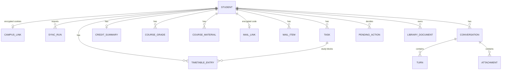
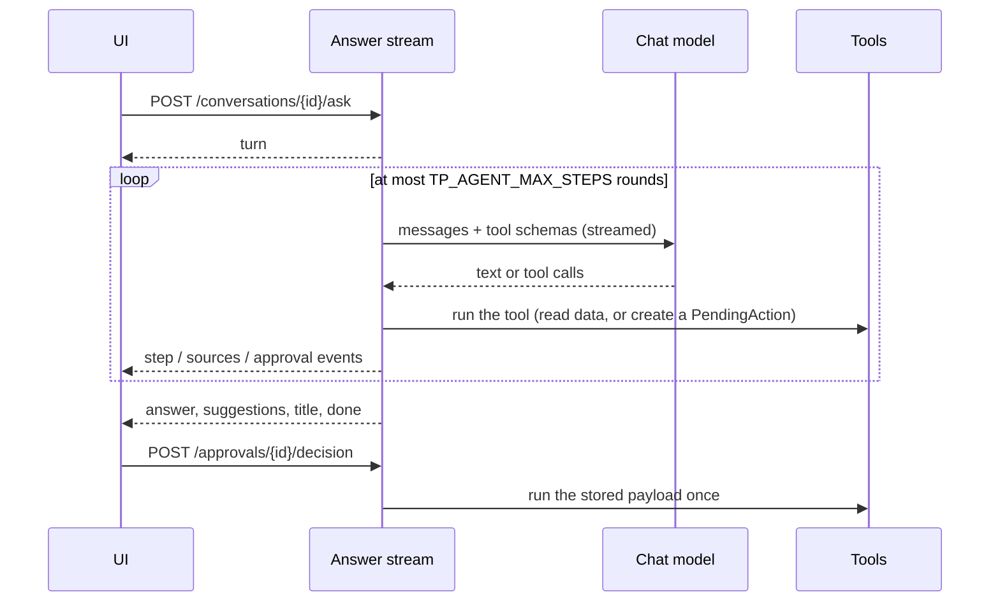

# Architecture

[中文版](architecture.zh-CN.md)

How TermPilot fits together, and why some parts are the way they are.

There are two parts. The FastAPI backend owns all the data and is the only thing that talks to campus
systems, the mailbox or the LLM. The frontend is a Nuxt single-page app, and the only thing the browser
keeps is a bearer token.

## Backend layers

```text
api/routes  ->  services  ->  adapters (campus, mail, chat model, search index)
                   |
                   v
                  db
```

`assistant/` sits beside `services/`: routes call into it, and its tools call the services.

- Routes (`termpilot/api`) are thin on purpose. They parse the request into a Pydantic model, call a
  service and convert the result into a response model. No business rules in there.
- Services (`termpilot/services`) are where the use cases live. When something goes wrong they raise one
  of the errors from `termpilot/errors.py` (`NotFound`, `CampusSessionExpired`, ...). One exception handler
  turns all of them into `{"error": {"code", "message", "details"}}`, so every error response has the
  same shape.
- Adapters wrap the external systems. Each is a small protocol with a real implementation and an offline one:

  | Protocol | Real implementation | Offline implementation |
  | --- | --- | --- |
  | `campus.gateway.CampusGateway` | `LiveCampusGateway` (CAS, records system, Blackboard) | `DemoCampusGateway` |
  | `mail.transport.MailTransport` | `ImapSmtpTransport` | `DemoTransport` |
  | `llm.client.ChatModel` | `OpenAICompatibleModel` | `ScriptedModel` (tests) |
  | `knowledge.index.LibraryIndex` | Elasticsearch via the adapted engine | fakes in the tests |

  The implementation is picked in the FastAPI dependencies in `api/deps.py`. Tests override those
  dependencies, so there is no monkeypatching anywhere.

## Data model



Some things the diagram doesn't show:

- All timestamps are stored in UTC. A custom column type (`UTCDateTime` in `db/base.py`) makes sure you
  always get timezone-aware datetimes back, SQLite included.
- A timetable entry is a weekly slot plus the list of teaching weeks it runs in (`[]` means every week).
  Imported courses have `origin = "records"` and are replaced on every sync. Once you edit one it counts as
  your own entry and the sync leaves it alone. Study blocks from the planner are single-week entries linked
  to their task.
- Tasks from Blackboard are matched on `(student, origin, external_ref)`. Syncing again updates the title and
  due date but keeps `done`, priority, effort and notes.

## Terms and teaching weeks

`campus/terms.py` works out the current term from the date: autumn runs from August to January, spring
from February to June, summer is July. For the Monday of week 1 it uses the first of these that applies:

1. the student's own setting (in Settings),
2. the deployment setting `TP_TERM_START_OVERRIDE`,
3. a guess based on the usual start dates.

A start date that obviously belongs to a different term is ignored, so an old setting doesn't break the
week numbers after the holidays.

`campus/periods.py` maps period numbers ("3-4节") to clock times and expands week specs such as "1-15单周".

## Campus sync

`services/campus_sync.py` runs six independent steps: profile, grades, timetable, deadlines, coursework and
materials. Each step commits on its own, so a page that fails to parse only fails that one step. If the
campus session has expired, the remaining steps are skipped with a "sign in again" message. Every run is
saved with a result per step and shown in Settings.

When you log in, no token is issued until the campus login has actually succeeded. Only the resulting
service cookies are kept, encrypted with a key derived from `TP_SECRET_KEY`.

## Assistant



- Tool calls use the provider's native function calling. In streaming mode a tool call arrives in pieces;
  `llm/client.py` puts them back together.
- Tools that only read run straight away. Tools that would change something (`draft_email`,
  `propose_task`, `propose_timetable_change`, `plan_study_time`, `propose_file_change`, `propose_rename`)
  just create a `PendingAction`. The payload stays on the server and the browser only gets a preview.
- Approving claims the action with an `UPDATE` that only matches while its status is still `pending`. A
  double click or two open tabs can't run it twice. Proposals expire after `TP_APPROVAL_TTL_MINUTES`
  (15 by default).
- With Deep think on, the tool loop still runs on the normal chat model and the reasoning model only writes
  the final answer from the collected evidence. Reasoning models are slow, and not every provider supports
  tool calls on them.
- Every answer is saved as a `Turn` with its sources, tool trace and suggested follow-up questions. If the
  connection drops halfway through, the partial answer is still saved.

## Document library

What happens on upload:

1. The file type and its magic bytes are checked.
2. The adapted RAGFlow code parses the file and splits it into chunks. PDFs go through the OCR and layout
   models.
3. The chunks are embedded in batches.
4. They go into a per-student Elasticsearch index, created with an explicit mapping.

Search combines BM25 and vector similarity, with optional reranking on top. The study aids (summary, quiz,
flashcards) read a document's chunks back in order and stream the result.

## Workspace files

Each student has a private folder under `var/workspaces`. Every path is resolved and checked against that
folder, so `..`, absolute paths and the trash folder are rejected. When the assistant proposes an edit, the
file's SHA-256 is stored with the proposal; if the file changes before you approve, the edit is refused.
Batch renames are all-or-nothing.

## Frontend

- `app/stores`: one Pinia store per area (session, planner, assistant, mail, files, campus, toasts).
- `app/utils`: helpers that don't depend on Nuxt (HTTP client, SSE parser, date maths, Markdown, GPA).
  These are the parts with unit tests in `tests/`.
- `app/components`: a few base components in `ui/` plus the feature components, which keeps the pages short.
- The answer stream is read from a `fetch` response body rather than `EventSource`, because `EventSource`
  can't send an `Authorization` header.
