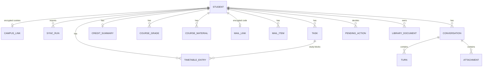
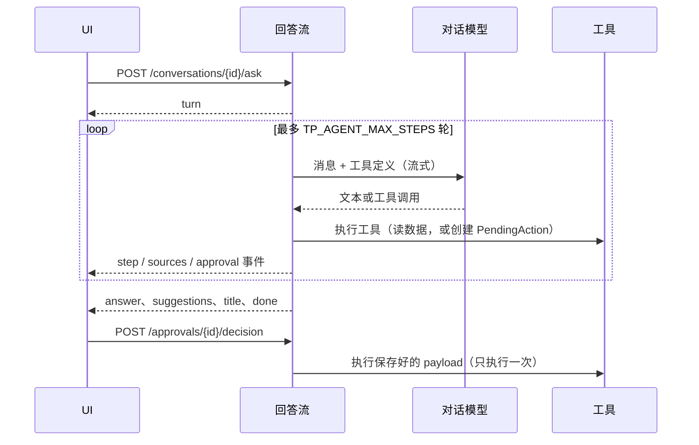

# 架构说明

[English](architecture.md) | 中文

> 英文版 [architecture.md](architecture.md) 的中文版，内容有出入时以英文版为准。

这里记一下 TermPilot 各部分是怎么拼起来的，以及有些地方为什么这么设计。

整个项目分两块：FastAPI 后端管所有数据，也只有它会去连校园系统、邮箱和大模型；前端是 Nuxt 写的单页应用，
浏览器里只存一个 bearer token。

## 后端分层

```text
api/routes  ->  services  ->  adapters（校园系统、邮件、对话模型、搜索索引）
                   |
                   v
                  db
```

`assistant/` 和 `services/` 是平级的：路由会调用它，它的工具再去调用各个 service。

- 路由（`termpilot/api`）故意写得很薄：把请求解析成 Pydantic 模型，调用 service，再把结果转成响应模型。业务规则不放在这一层。
- 服务（`termpilot/services`）是具体业务逻辑所在的地方。出错时抛 `termpilot/errors.py` 里定义的异常（`NotFound`、
  `CampusSessionExpired` 等），由一个统一的异常处理器转成 `{"error": {"code", "message", "details"}}`，
  所以所有错误响应的格式都是一样的。
- 适配器把外部系统包起来。每个都是一个小的 protocol，有一个真实实现和一个离线实现：

  | Protocol | 真实实现 | 离线实现 |
  | --- | --- | --- |
  | `campus.gateway.CampusGateway` | `LiveCampusGateway`（CAS、教务系统、Blackboard） | `DemoCampusGateway` |
  | `mail.transport.MailTransport` | `ImapSmtpTransport` | `DemoTransport` |
  | `llm.client.ChatModel` | `OpenAICompatibleModel` | `ScriptedModel`（测试用） |
  | `knowledge.index.LibraryIndex` | 通过改编后的引擎访问 Elasticsearch | 测试里的假实现 |

  用哪个实现由 `api/deps.py` 里的 FastAPI 依赖决定。测试直接覆盖这些依赖，所以整个项目没有用到 monkeypatch。

## 数据模型



图里看不出来的几点：

- 所有时间都按 UTC 存。`db/base.py` 里有一个自定义列类型 `UTCDateTime`，保证读出来的永远是带时区的 datetime，SQLite 也一样。
- 一条课表记录 = 每周的一个时间段 + 它在哪些教学周出现（`[]` 表示每周都有）。导入的课程 `origin = "records"`，
  每次同步都会整体替换；你改过的那条就算你自己的了，同步不会再动它。复习规划生成的时段是只在某一周出现的记录，并关联到对应任务。
- Blackboard 上的任务按 `(student, origin, external_ref)` 匹配。重新同步会更新标题和截止时间，但保留 `done`、优先级、预估时长和备注。

## 学期和教学周

`campus/terms.py` 根据日期判断当前是哪个学期：秋季学期是 8 月到次年 1 月，春季学期 2 月到 6 月，7 月是夏季学期。
第 1 周的周一按下面的顺序取第一个能用的：

1. 学生自己在设置里填的日期；
2. 部署配置 `TP_TERM_START_OVERRIDE`；
3. 按往年开学时间推出来的默认值。

如果填的开学日期明显属于别的学期，就会被忽略，这样放完假之后旧设置不会把周次算错。

`campus/periods.py` 负责把节次（"3-4节"）换算成具体时间，并展开"1-15单周"这类周次写法。

## 校园数据同步

`services/campus_sync.py` 分六步独立执行：个人信息、成绩、课表、截止日期、作业成绩、课程资料。每一步单独提交，
某个页面解析失败只会让那一步失败。如果校园登录已经过期，剩下的步骤会直接跳过，并提示重新登录。
每次同步的结果（每一步成功还是失败）都会保存，在设置页可以看到。

登录时，只有校园系统确认密码正确之后才会签发令牌。保存下来的只有登录后拿到的服务 Cookie，用 `TP_SECRET_KEY` 派生的密钥加密。

## 助手



- 工具调用用的是模型服务商原生的 function calling。流式输出时一个工具调用会被拆成好几段发过来，由 `llm/client.py` 拼回去。
- 只读的工具直接执行。会改东西的工具（`draft_email`、`propose_task`、`propose_timetable_change`、`plan_study_time`、
  `propose_file_change`、`propose_rename`）只会创建一个 `PendingAction`，payload 留在服务器上，浏览器只拿到预览。
- 批准时用一条带条件的 `UPDATE` 去"认领"这个操作，只有状态还是 `pending` 才会成功。所以就算双击了按钮、或者开了两个标签页，
  也只会执行一次。提案过了 `TP_APPROVAL_TTL_MINUTES`（默认 15 分钟）就会失效。
- 打开 Deep think 时，工具循环还是用普通对话模型跑，推理模型只负责根据收集到的资料写最后的回答。
  原因是推理模型比较慢，而且不是每家都支持在推理模型上调用工具。
- 每次回答都会存成一个 `Turn`，包括引用来源、工具调用记录和推荐的追问。连接中途断了，已经生成的部分也会保存。

## 资料库

上传一个文件时会经过这几步：

1. 检查文件类型和文件头（magic bytes）。
2. 用改编自 RAGFlow 的代码解析文件并切块，PDF 会经过 OCR 和版面分析模型。
3. 分批生成向量。
4. 写入这个学生自己的 Elasticsearch 索引（索引按显式 mapping 创建）。

检索时把 BM25 和向量相似度结合起来，可以再加一层重排序。复习提纲、练习题和抽认卡会按顺序读出某份资料的所有分块，再流式生成结果。

## 工作区文件

每个学生在 `var/workspaces` 下有一个私有目录。所有路径都会先解析、再检查是否在这个目录里，所以 `..`、绝对路径和回收站目录都会被拒绝。
助手提议修改某个文件时，会把文件当时的 SHA-256 一起存下来；如果批准之前文件已经变了，这次修改就会被拒绝。批量重命名要么全部成功，要么全部不做。

## 前端

- `app/stores`：每个功能区一个 Pinia store（session、planner、assistant、mail、files、campus、toasts）。
- `app/utils`：不依赖 Nuxt 的工具函数（HTTP 客户端、SSE 解析、日期计算、Markdown、GPA），单元测试都在 `tests/` 里。
- `app/components`：`ui/` 里是几个基础组件，其余是各功能的组件，这样页面文件本身可以写得很短。
- 回答流是从 `fetch` 的响应体里读的，没有用 `EventSource`，因为 `EventSource` 没法带 `Authorization` 请求头。
